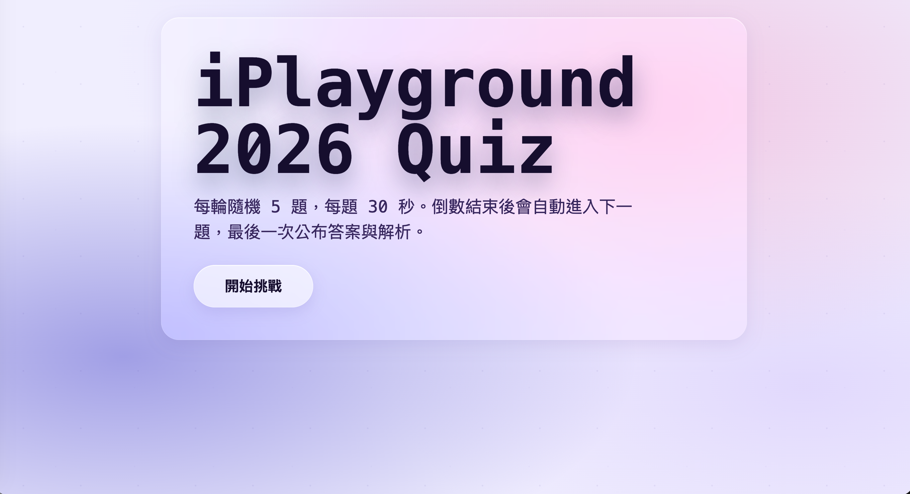
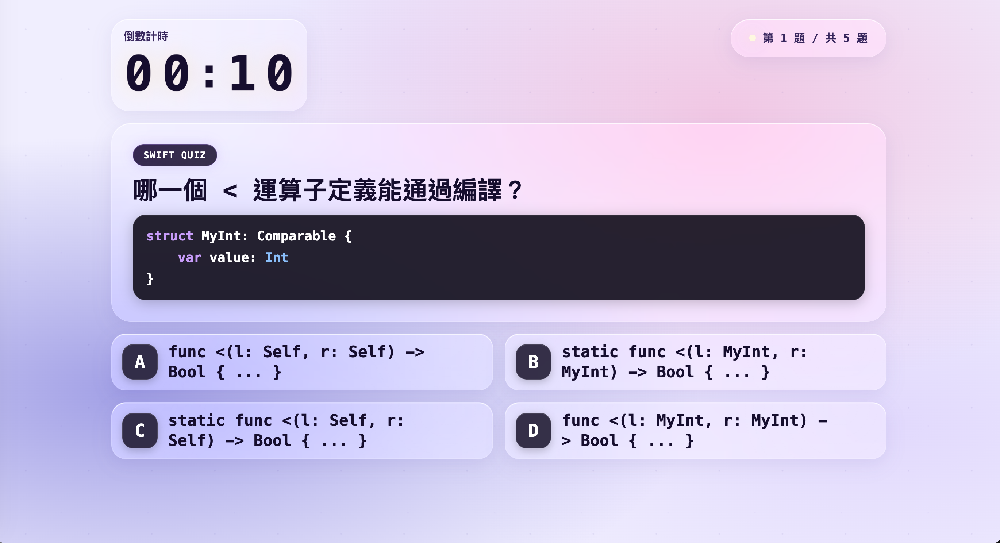
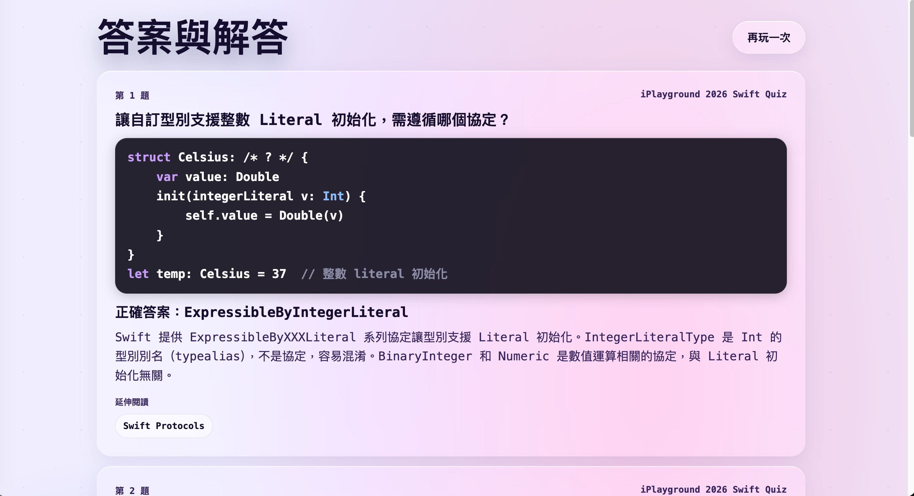

# iPlayground 2026 Swift Quiz

A static web quiz game for iPlayground 2026 Swift challenge questions. Each round randomly selects 5 questions from the question bank, shows a countdown timer per question, then reveals all answers and explanations at the end.

## Play

Start a local static server from this folder:

```sh
python3 -m http.server 8000
```

Open:

```text
http://localhost:8000/
```

Override the per-question timer for faster testing:

```text
http://localhost:8000/?duration=5
```

## Game Flow

1. Click **開始挑戰** on the start screen.
2. The game randomly selects 5 questions.
3. Each question is shown with a live countdown timer. When time runs out, the game automatically advances.
4. Multiple-choice questions: tap an option to lock in your answer. A circle (○) marks the correct answer; a cross (✕) marks a wrong pick.
5. Fill-in-the-blank questions: no choices are shown — answers are revealed at the end.
6. After all 5 questions, the result screen shows each question, the correct answer, and an explanation.

## UI

- Light glassmorphism theme throughout — start card, timer, progress pill, question card, and answer tiles all share the same frosted-glass style.
- Timer digits animate with a SwiftUI-style `numericText` slide effect (ones digit only).
- Correct / wrong feedback uses SVG circle and cross icons sized to match the A/B/C/D letter badges.

## Question Bank

Questions live in `iplayground2026_quiz_data.json`. Each entry has:

| Field | Description |
|---|---|
| `index` | Question number |
| `question` | Question text; code snippets wrapped in ` ```swift ``` ` fences |
| `answer` | Correct answer string |
| `choices` | Array of wrong-answer distractors (omit or leave `[]` for fill-in-the-blank) |
| `reason` | Explanation shown on the result screen |
| `author` | Attribution |

`buildDisplayChoices` automatically shuffles the correct answer together with the distractors, so **do not include the correct answer in `choices`**.

## Screenshots

### Start



### Question



### Results


