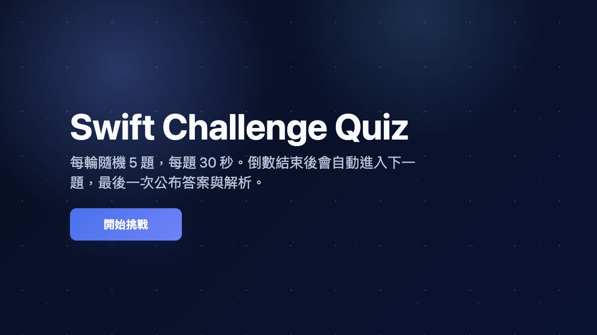
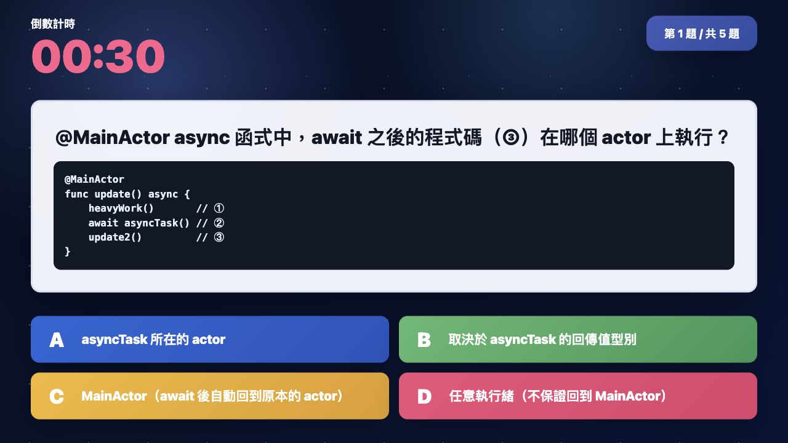
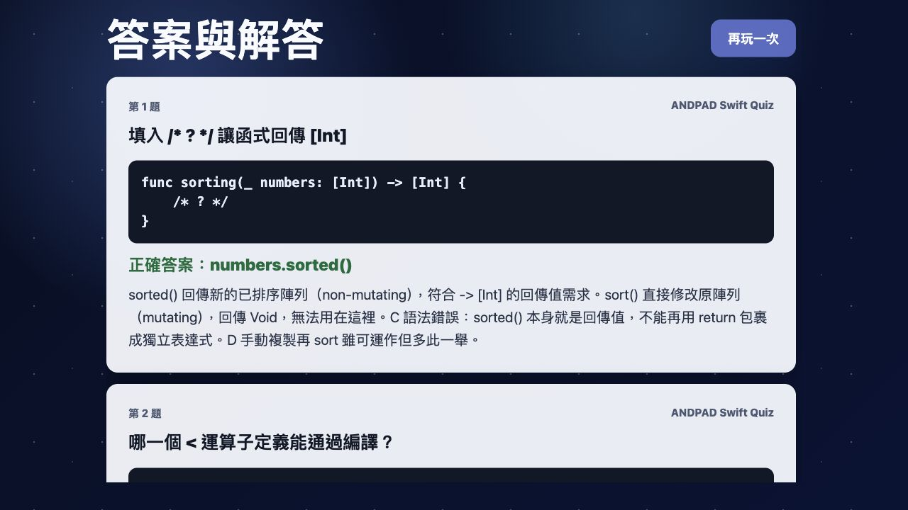

# iPlayground 2026 Quiz

A static web quiz game for iPlayground 2026 Swift challenge questions. It loads `iplayground2026_quiz_data.json`, randomly selects 5 questions, shows each question for 30 seconds, then displays the answers and explanations at the end.

## Play

Start a local static server from this folder:

```sh
python3 -m http.server 8000
```

Open:

```text
http://localhost:8000/
```

For faster testing, override the per-question timer:

```text
http://localhost:8000/?duration=1
```

## Game Flow

- Click `開始挑戰`.
- The game randomly selects 5 questions.
- Each question appears for 30 seconds with a visible countdown.
- The game automatically advances to the next question.
- After the fifth question, the result screen shows each answer and explanation.

## Screenshots

### Start



### Question



### Results


