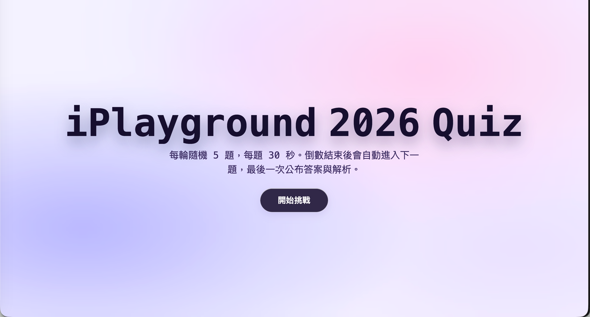
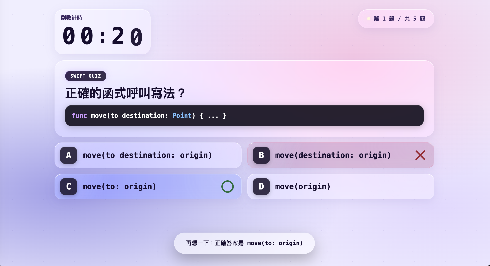

# iPlayground 2026 Swift Quiz

An interactive Swift quiz game for iPlayground 2026. Each round draws 5 random questions from the question bank, runs a per-question countdown, and reveals all answers with explanations at the end.

## Screenshots







## Getting Started

Serve the folder with any static HTTP server:

```sh
python3 -m http.server 8000
```

Then open:

```
http://localhost:8000/
```

Override the per-question timer (in seconds) via query string:

```
http://localhost:8000/?duration=10
```

## How to Play

1. The full-screen start page animates in — click **開始挑戰** to begin.
2. The game picks 5 random questions and shows them one at a time with a countdown timer.
3. **Multiple-choice** — tap an option to lock your answer.
   - ○ marks the correct answer in green.
   - ✕ marks your wrong pick in red, and the correct option is revealed.
4. **Fill-in-the-blank** — no options are shown; answers appear on the result screen.
5. When time runs out the game advances automatically.
6. After all 5 questions, the result screen lists every question, the correct answer, and an explanation.

## UI Details

| Feature | Implementation |
|---|---|
| Glass cards | Pure CSS `backdrop-filter: blur(24px) saturate(1.5)` — start, timer, progress, question, choices, and results all share the same frosted-glass style |
| Fullscreen start page | `:has(.start-card)` removes shell padding so the card fills 100 vw × 100 vh |
| Letter pull-up animation | Title text split into per-character `<span>` elements with staggered `animation-delay`, applied on both the start screen and each question |
| Numeric timer | Ones digit animates with a SwiftUI-style slide (old digit out upward, new digit in from below); tens digit updates instantly |
| Answer icons | SVG circle ○ and cross ✕ at 54 × 54 px, matching the A/B/C/D badge size |

## Question Bank

Questions are stored in `iplayground2026_quiz_data.json` as a JSON array. Each object:

| Field | Type | Description |
|---|---|---|
| `index` | number | Display order |
| `question` | string | Question text; Swift code wrapped in ` ```swift ``` ` fences |
| `answer` | string | The correct answer |
| `choices` | string[] | **Wrong-answer distractors only.** The correct answer is inserted automatically — do not duplicate it here. Leave `[]` for fill-in-the-blank questions. |
| `reason` | string | Explanation shown on the result screen |
| `author` | string | Attribution |
